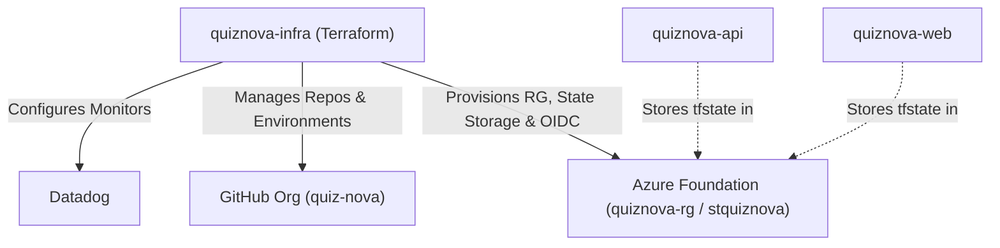

# QuizNova Infrastructure

Platform Infrastructure as Code for the
[`quiz-nova`](https://github.com/quiz-nova) organization, managed by
[Moamen Elbarky](https://github.com/moamenelbarky) using **Terraform**,
**Doppler**, and **GitHub Actions**.

**Live Application:** [quiznova.dev](https://quiznova.dev) _(Fallback:
[GitHub Pages](https://moamenelbarqy.github.io/quiz-nova/))_

> [!NOTE] **Demo Notice:** This infrastructure supports a demonstration and
> learning project. Serverless containers scale to zero (causing 10–15s initial
> cold starts), and live services may pause if free-tier cloud credits run out.

---

## Overview

This repository acts as the foundational control plane (`terraform/`) for the
QuizNova project:

- **GitHub Organization (`repositories.tf`, `environments.tf`)**: Manages public
  repositories, deployment environments (`development`, `staging`,
  `production`), and branch rules via a GitHub App (`quiznova-terraform-bot`).
- **Azure Foundation (`resource_group.tf`, `storage.tf`, `oidc.tf`)**:
  Provisions the shared resource group (`quiznova-rg`), remote Terraform state
  blob containers (`stquiznova`), and passwordless GitHub Actions OIDC identity
  federation.
- **Observability (`datadog.tf`)**: Configures Datadog error-rate monitors for
  the backend API.



For the story behind moving from manual Azure Portal clicks to Terraform and
Doppler, see the project wiki:

- [Infrastructure as Code (IaC) Journey](https://github.com/quiz-nova/quiznova-api/wiki/IaC)
- [Managing Secrets with Doppler](https://github.com/quiz-nova/quiznova-api/wiki/Doppler)

---

## Secrets & Doppler

Sensitive values required during Terraform runs are stored in **Doppler** under
the `quiznova-infra` project (`prd` config) and injected at runtime:

| Secret Name           | Purpose                            |
| :-------------------- | :--------------------------------- |
| `GITHUB_APP_PEM_FILE` | RSA private key for the GitHub App |
| `DATADOG_API_KEY`     | Datadog API key                    |
| `DATADOG_APP_KEY`     | Datadog Application key            |

Non-sensitive defaults live in `terraform/variables.tf`.

---

## Quick Start

### Prerequisites

- [Terraform](https://www.terraform.io/) (`>= 1.5.0`)
- [Doppler CLI](https://docs.doppler.com/docs/cli)

### Run Terraform via Doppler

```bash
# Initialize backend
doppler run --project quiznova-infra --config prd -- \
  terraform -chdir=terraform init

# Preview changes
doppler run --project quiznova-infra --config prd -- \
  terraform -chdir=terraform plan

# Apply changes
doppler run --project quiznova-infra --config prd -- \
  terraform -chdir=terraform apply
```

In CI/CD, `.github/workflows/terraform.yml` validates formatting, runs Checkov
security checks, plans on pull requests, and applies automatically on merges to
`main` using Azure and Doppler OIDC.

---

## Organization Repositories

| Repository                                                            | Purpose                               |
| :-------------------------------------------------------------------- | :------------------------------------ |
| [`quiznova-api`](https://github.com/quiz-nova/quiznova-api)           | .NET 10 Backend API                   |
| [`quiznova-web`](https://github.com/quiz-nova/quiznova-web)           | Angular 21 Web Application            |
| [`quiznova-infra`](https://github.com/quiz-nova/quiznova-infra)       | Platform Infrastructure as Code       |
| [`quiznova-api.wiki`](https://github.com/quiz-nova/quiznova-api/wiki) | Architecture Notes & Learning Journey |

---

## Author

Developed by **[Moamen Elbarky](https://github.com/moamenelbarky)**.
